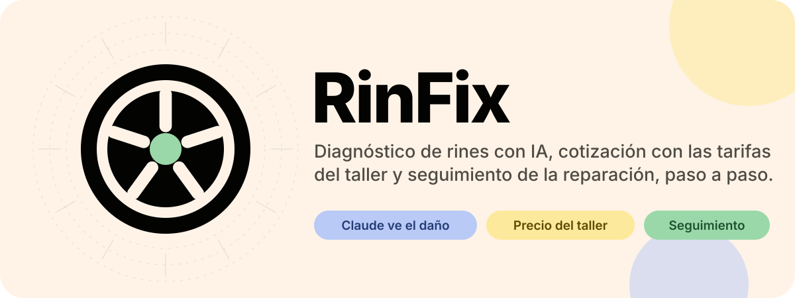
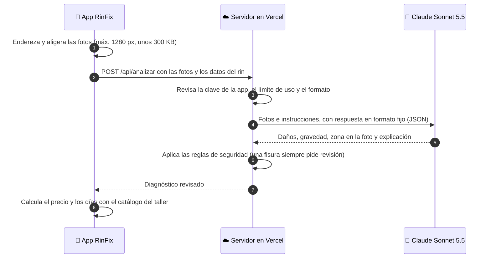
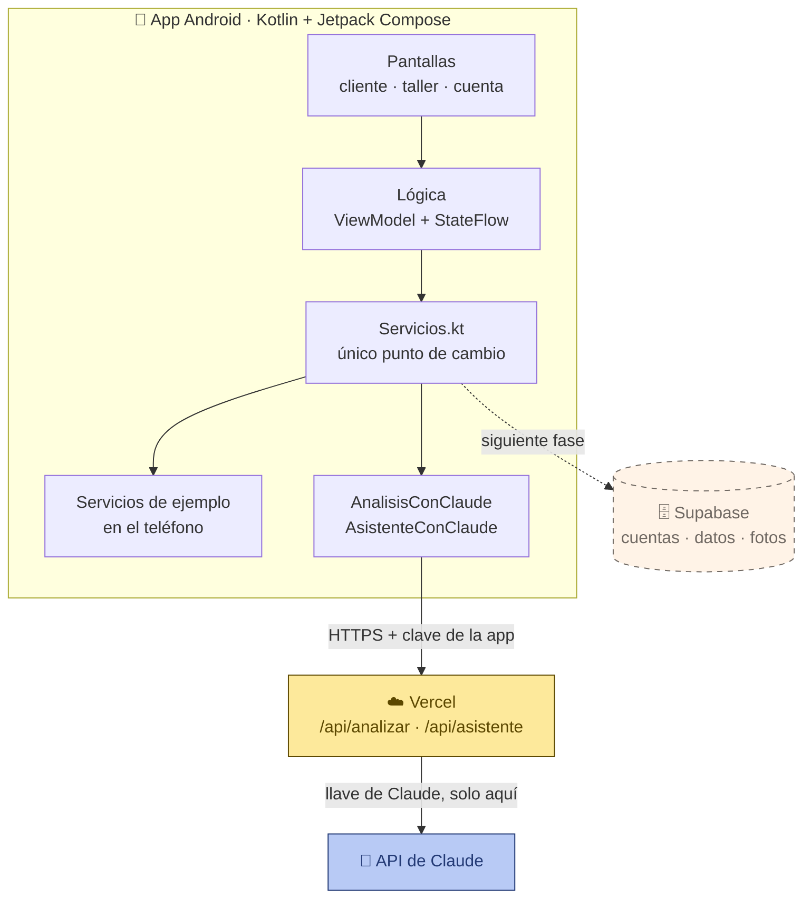
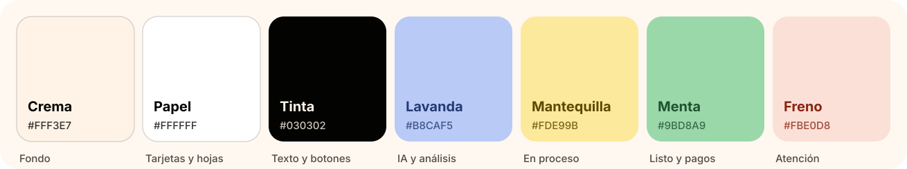

<div align="center">



<br>

[](https://github.com/Codemikey21/rimvision-android/actions/workflows/compilar-apk.yml)


**Le tomas una foto al rin, Claude identifica el daño, el taller cotiza y repara,<br>y tú ves cada paso con fotos, como el seguimiento de un pedido.**

[Qué hace](#qué-hace) | [Cómo funciona](#cómo-funciona) | [Qué es real hoy](#qué-es-real-hoy) | [Pruébala](#pruébala) | [Arquitectura](#arquitectura) | [Servidor](#servidor) | [Seguridad](#seguridad) | [Hoja de ruta](#hoja-de-ruta)

</div>

---

## Qué hace

RinFix es una app Android nativa con dos experiencias que se hablan entre sí: la del **cliente** que tiene el rin dañado y la del **taller** que lo repara. Lo que registra el taller le aparece al cliente al instante en su seguimiento y en sus avisos.

<table>
<tr>
<th width="50%">🚗 Cliente</th>
<th width="50%">🔧 Taller</th>
</tr>
<tr valign="top">
<td>

- **Analiza un rin** con la cámara o la galería, hasta 3 fotos, con aviso de luz y linterna.
- **Diagnóstico de Claude:** cada daño marcado sobre la foto, con su gravedad, qué tan seguro está y una explicación sencilla.
- **Cotización** en pesos con las tarifas del taller, según el tamaño y el material del rin.
- **Agenda la reparación** eligiendo día y hora libres.
- **Seguimiento en vivo** de las 7 etapas, con las fotos del antes, el durante y el después.
- **Pago simulado** con comprobante.
- **Asistente con Claude** que conoce tus órdenes, diagnósticos y carros.
- **Garaje**, historial, perfil y desbloqueo con huella.

</td>
<td>

- **Panel del día:** qué está en el taller, qué se entrega y las solicitudes nuevas.
- **Trabajos** con filtros por etapa, atrasados primero.
- **Detalle del trabajo:** el siguiente paso con confirmación, de «Recibir el rin» a «Entregar».
- **Cotización exacta** con los servicios del catálogo y la fecha de entrega.
- **Fotos de avance** con la cámara, marcadas como antes, durante o después.
- **Agenda** de 14 días: citas, entregas y horas que se pueden bloquear.
- **Estadísticas** de los últimos 90 días.
- Cobro registrado al entregar.

</td>
</tr>
</table>

---

## Cómo funciona

El recorrido completo, de la foto a la entrega:

```mermaid
flowchart LR
    A["📸 Foto del rin"] --> B["🤖 Claude identifica<br>los daños"]
    B --> C["💵 Cotización con<br>el catálogo"]
    C --> D["📅 Solicitud y cita"]
    D --> E["🔧 Reparación<br>en el taller"]
    E --> F["🖼️ Seguimiento<br>con fotos"]
    F --> G["💳 Pago simulado"]
    G --> H["✅ Entrega"]

    classDef ia fill:#B8CAF5,stroke:#233A75,color:#233A75
    classDef proceso fill:#FDE99B,stroke:#5C4800,color:#5C4800
    classDef listo fill:#9BD8A9,stroke:#1F5130,color:#1F5130
    class A,B ia
    class C,D,E proceso
    class F,G,H listo
```



<details>
<summary><b>🔍 Qué pasa por dentro al analizar una foto</b></summary>

<br>



- **La IA nunca pone precios.** Claude solo dice qué daños ve; el valor sale de las tarifas del taller.
- **Nunca dice que un rin es seguro.** Una fisura o una deformación siempre llevan aviso de revisión presencial.
- Si la foto no muestra un rin, o salió borrosa u oscura, la app lo dice y te devuelve a la cámara.

</details>

<details>
<summary><b>🧭 Las 7 etapas de una reparación</b></summary>

<br>

| # | Etapa | Quién la registra | Qué ve el cliente |
|:-:|---|---|---|
| 1 | Solicitud recibida | El cliente, desde la app | La cita agendada |
| 2 | Inspección en el taller | El taller, al recibir el rin | «El taller recibió tu rin» |
| 3 | Cotización aprobada | El taller, con el valor exacto | El total y el botón para pagar |
| 4 | Reparación en curso | El taller | Fotos del durante y en qué va |
| 5 | Control de calidad | El taller | Balanceo y revisión final |
| 6 | Listo para entrega | El taller | «Tu rin está listo para recoger» |
| 7 | Entregado | El taller, con el cobro registrado | La orden queda en su historial |

</details>

---

## Qué es real hoy

Este proyecto distingue lo que ya funciona de verdad, lo que es una simulación a propósito y lo que llega en la siguiente fase.

| Función | Estado | Detalle |
|---|:-:|---|
| Análisis de fotos con IA | ✅ Real | Claude Sonnet 5.5 en el servidor de Vercel |
| Asistente conversacional | ✅ Real | Claude Haiku 5.5, con los datos de la persona |
| Cotización | ✅ Real | Reglas y tarifas del catálogo, en pesos |
| Cámara, linterna y revisión de luz | ✅ Real | CameraX, en el teléfono |
| Desbloqueo con huella | ✅ Real | Android Keystore; RinFix nunca recibe la huella |
| Cuentas | ✅ En el teléfono | Contraseña cifrada (PBKDF2); a Supabase en la siguiente fase |
| Órdenes, fotos de avance y avisos | 🧪 En memoria | Funcionan entre los dos roles en el mismo teléfono |
| Pagos | 🧪 Simulados | A propósito: no se cobra dinero ni se guardan datos de tarjetas |
| Inicio con Google | 🧪 Ejemplo | Entra como la cuenta de ejemplo |
| Modelo YOLO del rin en el teléfono | ⏳ Siguiente fase | Entrenado en Colab (`ml/`); falta integrarlo |
| Datos en la nube y entre teléfonos | ⏳ Siguiente fase | Supabase con tiempo real |

> [!NOTE]
> Si el APK se compila sin la dirección del servidor, la app entra en **modo ejemplo**: todo funciona con datos de ejemplo y lo dice en pantalla.

---

## Pruébala

<details>
<summary><b>👤 Cuentas de prueba</b></summary>

<br>

| Rol | Correo | Contraseña | Qué trae |
|---|---|---|---|
| Cliente | `laura@correo.com` | `Rines2026!` | Una reparación en curso, un diagnóstico y dos carros |
| Taller | `taller@rinfix.co` | `Taller2026!` | Trabajos en varias etapas, citas y avisos |

Para crear un trabajador nuevo, usa **Unirse a un taller** con el código `RINFIX-TALLER`.

Estas contraseñas son públicas a propósito: son de las cuentas de ejemplo y desaparecen con Supabase.

</details>

<details>
<summary><b>📦 Compilar e instalar el APK</b></summary>

<br>

**Necesitas:** Android Studio reciente y un teléfono con Android 8.0 o superior.

1. Clona el repositorio y ábrelo en Android Studio.
2. Para conectar el análisis real, agrega al final de `local.properties` (ese archivo no se sube a GitHub):

   ```properties
   RINFIX_SERVIDOR=https://tu-proyecto.vercel.app
   RINFIX_CLAVE_APP=la-misma-clave-que-pusiste-en-vercel
   ```

   Sin estas líneas, la app funciona en modo ejemplo.
3. Haz **Sync** de Gradle.
4. **Build → Generate App Bundles or APKs → Generate APKs.**
5. El APK queda en `app/build/outputs/apk/debug/app-debug.apk`. Pásalo al teléfono por Drive, WhatsApp o correo, y ábrelo para instalarlo.

GitHub Actions también compila un APK en cada push (pestaña **Actions**), pero sale en modo ejemplo porque no tiene la dirección del servidor.

</details>

<details>
<summary><b>🎬 Recorrido sugerido para una demo</b></summary>

<br>

1. Entra como **Laura**, toca el rin del centro y analiza la foto de un rin dañado.
2. Revisa el diagnóstico y pide la reparación con una cita.
3. Cierra sesión y entra como **taller**: la solicitud aparece en el Panel y en la Agenda.
4. Recibe el rin, arma la cotización, empieza la reparación y sube fotos de avance.
5. Vuelve a **Laura**: el seguimiento muestra las fotos, la campana tiene los avisos y ya puede pagar.
6. Cierra con el **Asistente**: «¿Cómo va mi reparación?» y «¿Puedo viajar con el rin así?».

No cierres la app del todo durante la demo: las órdenes viven en memoria hasta que llegue Supabase.

</details>

---

## Arquitectura



Cada pantalla tiene su archivo de lógica con el mismo nombre (por ejemplo, `cliente/Inicio.kt` y `cliente/InicioLogica.kt`). Los servicios son interfaces: hoy unos funcionan con datos de ejemplo y otros con Claude, y al conectar Supabase solo cambia `datos/Servicios.kt`.

<details>
<summary><b>📁 Carpetas del proyecto</b></summary>

<br>

| Carpeta | Qué contiene |
|---|---|
| `app/.../cliente/` | Pantallas del cliente: Inicio, Analizar, Resultado, Agendar, Seguimiento, Pago, Asistente, Garaje |
| `app/.../taller/` | Pantallas del taller: Panel, Trabajos, Detalle del trabajo, Registrar avance, Agenda |
| `app/.../cuenta/` | Acceso, registro, huella y perfil |
| `app/.../datos/` | Modelos, servicios de ejemplo, servicios con Claude y la conexión con el servidor |
| `app/.../componentes/` | Piezas reutilizables: botones, tarjetas, línea de tiempo, cámara, avisos |
| `app/.../diseno/` | Colores, letras, formas, sombras y movimiento |
| `app/.../seguridad/` | Desbloqueo con huella con Android Keystore |
| `app/.../ia/` | Preparación de fotos y revisión de luz en el teléfono |
| `servidor/` | Funciones de Vercel que hablan con Claude ([LEEME](servidor/LEEME.md)) |
| `ml/` | Entrenamiento del modelo YOLO en Google Colab ([README](ml/README.md)) |
| `docs/` | Documentación ([arquitectura](docs/arquitectura.md)) |

Los nombres de archivos y carpetas están en español a propósito.

</details>

<details>
<summary><b>🧰 Tecnologías</b></summary>

<br>

| Capa | Tecnología |
|---|---|
| App | Kotlin 2.2, Jetpack Compose (BOM 2026.02), Material 3 personalizado, Navigation Compose |
| Arquitectura | MVVM con ViewModel, corrutinas y StateFlow |
| Cámara | CameraX 1.6 con análisis de luz en vivo |
| Seguridad | Biometric 1.1 y Android Keystore (AES-GCM) |
| Servidor | Vercel Functions con Node 22 y TypeScript |
| IA | Claude Sonnet 5.5 para las fotos y Claude Haiku 5.5 para el asistente, con salida estructurada |
| Modelo propio | YOLOv8 entrenado en Google Colab, exportado a LiteRT |
| Automatización | GitHub Actions compila el APK en cada push |

</details>

---

## Diseño

Fondo crema, hojas blancas y bloques de color pastel. Cada color significa algo y se usa igual en toda la app:



La app tiene animaciones con propósito: el rin que entra girando al abrir, los pasos del análisis que aparecen uno a uno, la línea de tiempo que se llena, los números que suben en el panel y las confirmaciones que vibran.

---

## Servidor

La carpeta [`servidor/`](servidor/LEEME.md) se publica en Vercel. La app nunca tiene la llave de Claude: le pide al servidor y el servidor llama a Claude.

| Ruta | Qué hace |
|---|---|
| `GET /api/estado` | Dice si el servidor responde y si ya tiene las llaves puestas, sin mostrarlas |
| `POST /api/analizar` | Recibe de 1 a 3 fotos y devuelve los daños visibles |
| `POST /api/asistente` | Conversación libre del asistente con los datos de la persona |

<details>
<summary><b>⚙️ Variables de entorno en Vercel</b></summary>

<br>

| Nombre | Qué es |
|---|---|
| `ANTHROPIC_API_KEY` | La llave de la API de Claude |
| `RINFIX_CLAVE_APP` | La clave que la app manda en cada solicitud |
| `MODELO_ANALISIS` | Opcional: otro modelo para el análisis |
| `MODELO_ASISTENTE` | Opcional: otro modelo para el asistente |

Los pasos completos para publicarlo están en [`servidor/LEEME.md`](servidor/LEEME.md).

</details>

---

## Seguridad

- 🔑 **La llave de Claude vive solo en Vercel**, nunca en el APK ni en el repositorio.
- 🚦 **El servidor limita el uso:** pide la clave de la app, limita las solicitudes por IP y el tamaño de las fotos. Además, el espacio de trabajo de Anthropic tiene un tope de gasto.
- 🔒 **Contraseñas cifradas** con PBKDF2 y sal; nunca se guardan tal cual.
- 👆 **La huella nunca sale del teléfono:** Android la revisa y a RinFix solo le dice si coincidió.
- 💳 **Pagos simulados:** no se procesa dinero real ni se guardan datos financieros.
- 🙈 **Archivos privados fuera de git:** `local.properties`, `.env` y las llaves de Kaggle o Roboflow nunca se suben.

---

## Hoja de ruta

- [x] Diseño completo de los dos roles, con animaciones
- [x] Cámara, galería y revisión de luz
- [x] Desbloqueo con huella
- [x] Servidor en Vercel con Claude para fotos y asistente
- [x] Cotización con el catálogo del taller
- [x] Seguimiento con fotos, pagos simulados y agenda del taller
- [ ] Supabase: cuentas, datos y fotos en la nube, con tiempo real entre teléfonos
- [ ] Inicio de sesión con Google
- [ ] Modelo YOLO en el teléfono para encontrar el rin antes de enviarlo
- [ ] Clave de firma fija y versiones publicadas en Releases

---


<br>
<sub>RinFix · Bucaramanga, Colombia</sub>
</div>
